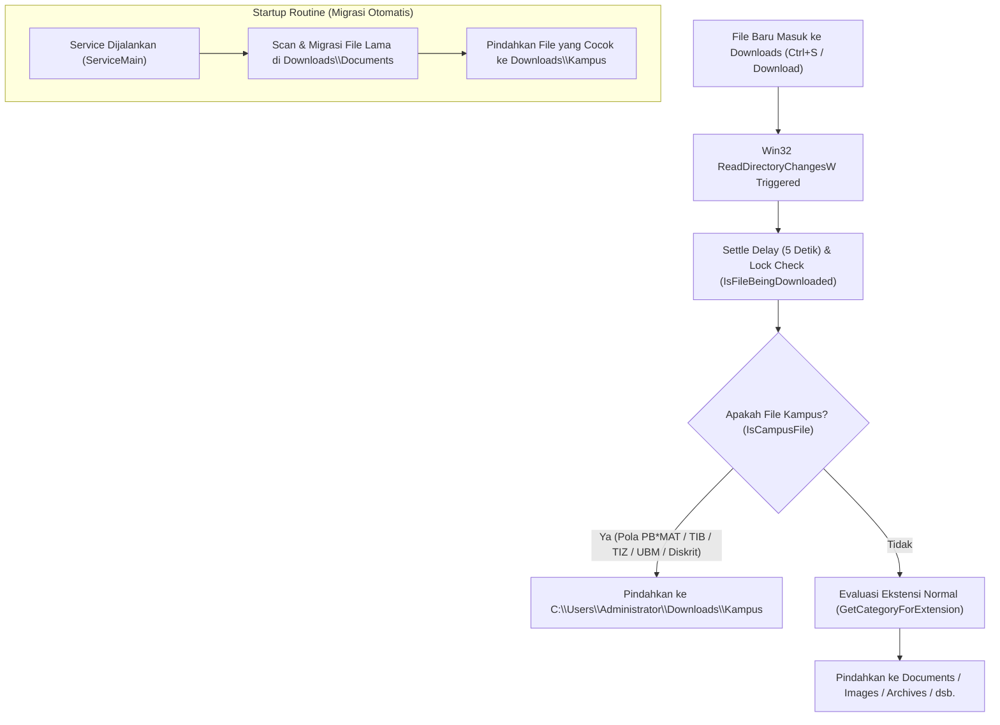

# Implementation Plan - DownloadsOrganizeSvc (Campus File Organizer)

Dokumen rencana teknis untuk menambahkan fitur pemisahan file materi perkuliahan/kampus pada service Windows yang sudah ada (`DownloadOrganizerSvc`), sehingga file kampus tidak lagi bercampur dengan dokumen umum di `Downloads\Documents`, melainkan diarahkan otomatis ke `C:\Users\Administrator\Downloads\Kampus`.

---

## Goal Description

Saat ini, `service.exe` (PID yang berjalan otomatis saat boot di bawah SCM Windows) memantau `C:\Users\Administrator\Downloads` menggunakan Win32 `ReadDirectoryChangesW`. Service memindahkan file berdasarkan ekstensi ke dalam folder:
* `Images`, `Documents`, `Archives`, `Installers`, `Audio`, `Video`, dan `Other`.

**Masalah:**  
File materi kuliah seperti `PB2MAT+Pertemuan2.pdf`, `PB10MAT_TIZ22 - 9 Arsitektur...`, dan file bertanda `TIB`, `TIZ`, `UBM`, serta `Diskrit` masuk ke folder `Downloads\Documents` dan bercampur dengan file umum (seperti laporan CSV absensi, file panduan `.md`, tiket, recovery code, dll.).

**Solusi:**  
Memperbarui kode sumber C (`service.c`) di proyek `C:\Users\Administrator\Documents\Github Project\SUDAH JADI\DownloadsOrganizeSvc` agar:
1. Mendeteksi file materi kampus melalui pola nama file dan kata kunci spesifik.
2. Memindahkan file tersebut langsung ke `C:\Users\Administrator\Downloads\Kampus`.
3. Menjalankan fungsi migrasi satu kali saat service dimulai untuk memindahkan file kampus yang saat ini telanjur berada di dalam `Downloads\Documents` ke `Downloads\Kampus`.

---

## User Review Required

> [!IMPORTANT]
> - **Kompilasi MSVC Native:** Service ini ditulis dalam bahasa C murni tanpa dependensi C Runtime library (`/GS-`, `/ENTRY:mainCRTStartup`, link ke `kernel32.lib` & `advapi32.lib`). Binary hasil kompilasi berukuran sangat kecil (~11 KB) dan menggunakan memori RAM < 2 MB.
> - **Service Name:** `DownloadOrganizerSvc` (Display Name: *Download Folder Organizer Service*).
> - **Aturan Deteksi Kampus:**
>   1. Awalan/Pola Materi: `PB` + angka + `MAT` (Contoh: `PB2MAT+...`, `PB10MAT_...`, `PB8MAT+...`).
>   2. Kata Kunci Mata Kuliah / Kampus: `TIB`, `TIZ`, `UBM`, `Diskrit` (case-insensitive).
>   3. Ekstensi yang Berlaku: Seluruh format dokumen & arsip materi (`pdf`, `doc`, `docx`, `xls`, `xlsx`, `ppt`, `pptx`, `txt`, `csv`, `zip`, `rar`, `7z`).

---

## Alur Kerja Baru (Architecture Flowchart)



---

## Proposed Changes

### Proyek: `C:\Users\Administrator\Documents\Github Project\SUDAH JADI\DownloadsOrganizeSvc`

#### [MODIFY] `service.c`

1. **Definisi Kategori Baru & Konstanta:**
   ```c
   #define CATEGORY_KAMPUS L"Kampus"
   ```

2. **Fungsi Helper Pencarian Substring Case-Insensitive (Pure Win32):**
   ```c
   // Case-insensitive substring search without CRT
   static BOOL StrContainsNoCaseW(const WCHAR *str, const WCHAR *substr) {
       if (!str || !substr || !*substr) return FALSE;
       DWORD subLen = StrLenW(substr);
       while (*str) {
           DWORD i = 0;
           while (str[i] && substr[i] && ToLowerW(str[i]) == ToLowerW(substr[i])) {
               i++;
           }
           if (i == subLen) return TRUE;
           str++;
       }
       return FALSE;
   }
   ```

3. **Fungsi Deteksi Pola `PB*MAT` (Misal `PB2MAT`, `PB10MAT`, `PB11MAT`):**
   ```c
   static BOOL HasPBMATPattern(const WCHAR *str) {
       if (!str) return FALSE;
       while (*str) {
           if ((str[0] == L'P' || str[0] == L'p') && (str[1] == L'B' || str[1] == L'b')) {
               const WCHAR *p = str + 2;
               // Harus ada minimal 1 digit angka di antara PB dan MAT
               if (*p >= L'0' && *p <= L'9') {
                   while (*p >= L'0' && *p <= L'9') p++;
                   if ((p[0] == L'M' || p[0] == L'm') &&
                       (p[1] == L'A' || p[1] == L'a') &&
                       (p[2] == L'T' || p[2] == L't')) {
                       return TRUE;
                   }
               }
           }
           str++;
       }
       return FALSE;
   }
   ```

4. **Fungsi Evaluasi `IsCampusFile(const WCHAR *fileName)`:**
   ```c
   static BOOL IsCampusFile(const WCHAR *fileName) {
       const WCHAR *ext = GetFileExt(fileName);
       
       // Periksa ekstensi materi (dokumen & arsip)
       static const WCHAR *academicExts[] = {
           L"pdf", L"doc", L"docx", L"xls", L"xlsx",
           L"ppt", L"pptx", L"txt", L"csv", L"zip", L"rar", L"7z"
       };
       BOOL extValid = FALSE;
       for (DWORD i = 0; i < sizeof(academicExts) / sizeof(academicExts[0]); i++) {
           if (StrEqualNoCaseW(ext, academicExts[i])) {
               extValid = TRUE;
               break;
           }
       }
       if (!extValid) return FALSE;

       // 1. Pola PB*MAT (e.g. PB2MAT+Pertemuan2.pdf, PB10MAT_TIZ22...)
       if (HasPBMATPattern(fileName)) {
           return TRUE;
       }

       // 2. Kode mata kuliah / kampus
       static const WCHAR *campusKeywords[] = {
           L"TIB", L"TIZ", L"UBM", L"Diskrit"
       };
       for (DWORD i = 0; i < sizeof(campusKeywords) / sizeof(campusKeywords[0]); i++) {
           if (StrContainsNoCaseW(fileName, campusKeywords[i])) {
               return TRUE;
           }
       }

       return FALSE;
   }
   ```

5. **Pembaruan `IsManagedCategoryFolder`:**
   Menambahkan `CATEGORY_KAMPUS` ke dalam daftar folder yang dikelola agar service tidak mengutak-atik isi folder `Kampus` sebagai folder lepas.
   ```c
   static BOOL IsManagedCategoryFolder(const WCHAR *folderName) {
       if (StrEqualNoCaseW(folderName, CATEGORY_KAMPUS)) return TRUE;
       for (DWORD i = 0; i < CATEGORY_COUNT; i++) {
           if (StrEqualNoCaseW(folderName, g_Categories[i].CategoryName)) return TRUE;
       }
       if (StrEqualNoCaseW(folderName, CATEGORY_OTHER)) return TRUE;
       return FALSE;
   }
   ```

6. **Pembaruan `ProcessFileItem`:**
   Mengarahkan ke `CATEGORY_KAMPUS` jika terdeteksi sebagai file kampus:
   ```c
   static void ProcessFileItem(const WCHAR *baseDir, const WCHAR *fileName) {
       const WCHAR *ext = GetFileExt(fileName);
       if (IsTemporaryOrPartial(ext)) return;

       const WCHAR *category = NULL;
       if (IsCampusFile(fileName)) {
           category = CATEGORY_KAMPUS;
       } else {
           category = GetCategoryForExtension(ext);
       }
       ...
   }
   ```

7. **Fitur Migrasi Satu Kali (`MigrateExistingDocuments`):**
   Dipanggil satu kali pada saat service startup (`ServiceMain`). Fungsi ini menyisir folder `C:\Users\Administrator\Downloads\Documents`. Setiap file yang memenuhi kriteria `IsCampusFile` akan langsung dipindahkan ke `C:\Users\Administrator\Downloads\Kampus`.
   ```c
   static void MigrateExistingDocuments(const WCHAR *watchPath) {
       WCHAR docDir[MAX_PATH];
       CopyStrW(docDir, watchPath, MAX_PATH);
       AppendStrW(docDir, L"\\Documents", MAX_PATH);

       WCHAR kampusDir[MAX_PATH];
       CopyStrW(kampusDir, watchPath, MAX_PATH);
       AppendStrW(kampusDir, L"\\" CATEGORY_KAMPUS, MAX_PATH);
       EnsureDirectoryExists(kampusDir);

       WCHAR searchPattern[MAX_PATH];
       CopyStrW(searchPattern, docDir, MAX_PATH);
       AppendStrW(searchPattern, L"\\*", MAX_PATH);

       WIN32_FIND_DATAW fd;
       HANDLE hFind = FindFirstFileW(searchPattern, &fd);
       if (hFind == INVALID_HANDLE_VALUE) return;

       do {
           if (fd.dwFileAttributes & FILE_ATTRIBUTE_DIRECTORY) continue;
           if (IsCampusFile(fd.cFileName)) {
               WCHAR srcPath[MAX_PATH];
               CopyStrW(srcPath, docDir, MAX_PATH);
               AppendStrW(srcPath, L"\\", MAX_PATH);
               AppendStrW(srcPath, fd.cFileName, MAX_PATH);

               WCHAR destPath[MAX_PATH];
               BuildUniqueTargetPath(kampusDir, fd.cFileName, destPath, MAX_PATH);

               MoveFileExW(srcPath, destPath, MOVEFILE_COPY_ALLOWED);
           }
       } while (FindNextFileW(hFind, &fd));

       FindClose(hFind);
   }
   ```

---

## Verification Plan

### Automated Build Verification
1. Jalankan `build.bat` dari direktori `DownloadsOrganizeSvc`:
   ```cmd
   cd "C:\Users\Administrator\Documents\Github Project\SUDAH JADI\DownloadsOrganizeSvc"
   call build.bat
   ```
   *Ekspektasi:* Kompilasi sukses dengan exit code 0 tanpa error CRT intrinsics.

### Service Update & Restart
1. Jalankan `update_service.bat` (atau `sc stop` -> copy -> `sc start`):
   ```powershell
   Stop-Service -Name DownloadOrganizerSvc
   # compile ulang service.exe
   Start-Service -Name DownloadOrganizerSvc
   ```
   *Ekspektasi:* Service masuk ke state `Running`.

### Manual Testing & Verification
1. **Verifikasi Migrasi Dokumen Lama:**
   * Periksa folder `C:\Users\Administrator\Downloads\Kampus`:
     * File-file berikut harus sudah otomatis berpindah ke `Kampus`:
       - `PB2MAT+Pertemuan2.pdf`
       - `PB3MAT+Pertemuan3.pdf`
       - `PB4MAT+Pertemuan4.pdf`
       - `PB6MAT+Grammar Exercise Graded.pdf`
       - `PB7MAT+Practice English .pdf`
       - `PB7MAT_TIB21-06-UnpredictedLoop.pdf`
       - `PB8MAT+Modal and noun practices.pdf`
       - `PB8MAT+TUGAS 3-MATEMATIKA DISKRIT.pdf`
       - `PB8MAT_TIB21-07-PredictedLoop.pdf`
       - `PB10MAT_TIZ22 - 9 Arsitektur dan Alur Kerja.pdf`
       - `PB11MAT_TIZ22 - 10 Inovasi AI Generatif - Part II.pdf`
   * Periksa folder `C:\Users\Administrator\Downloads\Documents`:
     * File umum (seperti `API-ENDPOINT-REFERENCE.md`, `gema-laporan-absensi-2026-09.csv`, `SKILL.md`, `vercel-recovery-codes-*.txt`) **tetap bertahan** di `Documents`.
2. **Pengujian File Baru:**
   * Buat file uji coba baru di `C:\Users\Administrator\Downloads\PB12MAT_TIB21_Test.pdf`.
   * Tunggu 5 detik (settle delay).
   * Pastikan file otomatis berpindah ke `C:\Users\Administrator\Downloads\Kampus\PB12MAT_TIB21_Test.pdf`.
